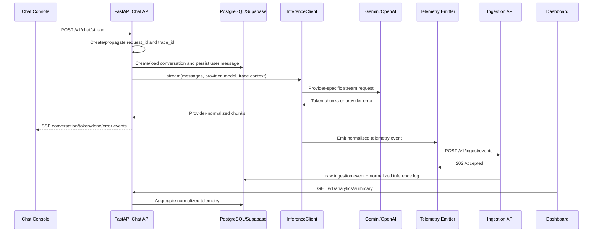
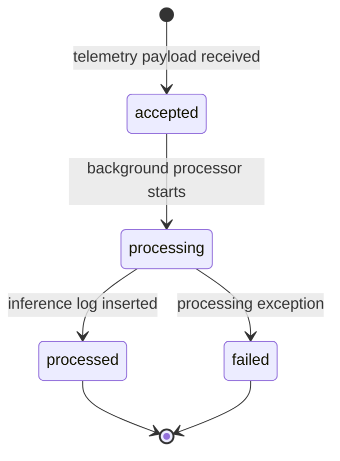

# Architecture Notes

These notes document the Ollive inference platform as an operational system, not as a chatbot implementation. The system is a lightweight AI inference observability platform: a chat workload, an SDK boundary around provider calls, decoupled telemetry emission, an ingestion pipeline, PostgreSQL/Supabase persistence, and an operational dashboard that makes inference behavior inspectable.

The architectural goal is to demonstrate platform engineering judgment: isolate user-facing inference from telemetry persistence, normalize provider-specific behavior into stable contracts, preserve traceability across async workflows, and make degraded states visible rather than accidental.

## System Overview

The platform is organized around explicit workload, control, and observability boundaries.

```text
Browser Chat Console
  -> FastAPI Chat API
  -> llm_sdk InferenceClient
  -> Gemini/OpenAI Provider Adapter
  -> Provider API or Mock Provider Mode
  -> Normalized Telemetry Event
  -> Best-effort Telemetry Emitter
  -> Ingestion API
  -> Background Processing
  -> ingestion_events + inference_logs
  -> Analytics API
  -> Operations Dashboard
```

The important design decision is that provider execution, telemetry emission, ingestion processing, and dashboard analytics are distinct operational concerns.

### Runtime Components

- `apps/frontend`: Next.js chat console, provider selector, conversation workspace, SSE client, telemetry inspector.
- `apps/api`: FastAPI service containing chat routes, ingestion routes, analytics routes, request context middleware, persistence, and service-layer orchestration.
- `packages/llm_sdk`: lightweight SDK that owns provider selection, provider normalization, timing, retry boundaries, telemetry construction, redaction, and telemetry emission.
- `apps/dashboard`: Next.js operational dashboard for request volume, latency, failures, provider health, ingestion state, trace inspection, and recent inference timeline.
- `infrastructure`: Docker, Kubernetes, Supabase overlay, local PowerShell process wrappers, database checks, and E2E smoke tests.

The API is intentionally stateless outside PostgreSQL/Supabase and provider credentials. Conversation memory is persisted, sessions are client-supplied, and request context is held only for the request lifecycle.

## Architecture Philosophy

The system is built around four operational principles.

### 1. Inference Should Not Depend On Telemetry Storage

Inference is user-facing. Telemetry persistence is operational. The SDK emits telemetry through a short-timeout, best-effort HTTP emitter. If ingestion is slow or unavailable, inference should not fail solely because the observability path is degraded.

This is why the SDK emits telemetry asynchronously via `FireAndForgetTelemetryEmitter` instead of writing directly to PostgreSQL.

### 2. Provider APIs Should Not Leak Into Application Or Analytics Code

Gemini and OpenAI have different request payloads, streaming formats, authentication methods, usage fields, and error envelopes. The platform hides those differences behind `BaseProvider` and normalizes them into `InferenceResult` and `TelemetryEvent`.

This gives the dashboard a stable analytical contract independent of provider API shape.

### 3. Every Inference Attempt Is Operational Data

Successful inference is telemetry. Failed inference is also telemetry. A quota error, timeout, bad API key, or provider-side error is valuable operational signal because it explains user-facing degradation.

The SDK emits failed telemetry with provider, model, latency, trace ID, request ID, error type, and redacted prompt preview when provider execution fails.

### 4. Local Simplicity Should Preserve Production Boundaries

The prototype keeps chat, ingestion, and analytics inside one FastAPI service to keep Docker Compose and local review lightweight. Internally, it still uses separate routers, services, repositories, SDK contracts, provider adapters, telemetry emitters, and ingestion state tables.

That makes future extraction into independent services straightforward without prematurely adding distributed infrastructure.

## End-to-End Request Lifecycle

The primary path is `POST /v1/chat/stream`.



### Chat API Responsibilities

The chat service owns conversation semantics:

- Create or resume conversations.
- Reject messages to cancelled conversations.
- Persist user messages before inference.
- Build short context from the latest 10 messages plus a system prompt.
- Resolve selected provider/model through the SDK.
- Persist assistant messages after successful stream completion.
- Emit structured logs for inference start, completion, and failure.

The service does not construct telemetry itself. It passes conversation/session/request context into the SDK so telemetry is emitted consistently for both JSON and SSE execution paths.

### Conversation Semantics

Conversation state is durable:

- `conversations.status` tracks `active` or `cancelled`.
- `chat_messages` stores user and assistant turns.
- Assistant messages include provider, model, and token count.
- New conversation titles are redacted from the initial prompt preview.

Cancellation is a conversation lifecycle state, not a streaming transport abort. Once a conversation is cancelled, subsequent attempts to append to it are rejected with `409`.

## Ingestion Flow

The ingestion pipeline is deliberately separate from provider execution. The SDK emits HTTP telemetry to the ingestion endpoint instead of linking directly to repositories or database sessions.



Concrete behavior:

1. `HttpTelemetryEmitter` posts the SDK event to `/v1/ingest/events`.
2. The ingestion route validates the payload with Pydantic.
3. The route returns `202 Accepted` immediately.
4. FastAPI schedules `_process_event` as a background task.
5. `IngestionService` inserts an `ingestion_events` row with raw JSON payload and `accepted` status.
6. The service marks the row `processing` and increments `retry_count`.
7. The service writes a normalized `inference_logs` row.
8. The service marks the ingestion event `processed`.
9. If normalization/storage fails, the service attempts to mark the event `failed` and records the error message.

This gives the platform two operational surfaces:

- `ingestion_events`: raw payload, processing state, retry count, failure visibility.
- `inference_logs`: normalized analytical facts used by dashboards.

## Telemetry Strategy

Telemetry is built inside `InferenceClient`, not in route handlers. That is intentional: the SDK is the only layer that consistently sees every provider call across streaming, non-streaming, success, and failure.

Each telemetry event captures:

- `event_id`
- `trace_id`
- `request_id`
- `correlation_id`
- `provider`
- `model`
- `status`
- request and response timestamps
- `latency_ms`
- token usage
- conversation/session IDs
- redacted request and response previews
- error type and error message
- metadata such as transport and attempt count

### Telemetry Persistence Semantics

The system is intentionally best-effort at the SDK emission layer and stateful at the ingestion layer.

At the SDK boundary:

- Telemetry emission is asynchronous.
- Delivery timeout is short.
- Delivery retries are bounded.
- Failed delivery logs `telemetry_emit_failed`.
- User-facing inference is not rolled back because telemetry delivery failed.

At the ingestion boundary:

- Events are accepted by ID.
- Raw payloads are stored before normalization.
- Processing state is visible.
- Duplicate `event_id` values are ignored to avoid double-counting.
- Normalized logs power analytics.

This split models a common production pattern: non-blocking telemetry emission from hot paths, followed by a more accountable ingestion pipeline.

## Logging & Traceability

Traceability starts at API middleware.

`RequestContextMiddleware`:

- Accepts incoming `x-request-id` and `x-trace-id`.
- Generates a UUID request ID if absent.
- Defaults trace ID to request ID if absent.
- Stores both IDs in context variables.
- Adds IDs to response headers.
- Logs `request_completed` with method, path, status code, and latency.
- Logs `request_failed` with request and trace context.

The IDs then flow through:

```text
middleware context
  -> ChatService logs
  -> InferenceClient telemetry
  -> ingestion_events
  -> inference_logs
  -> dashboard timeline and trace inspector
```

Traceability matters because LLM incidents often cross multiple systems: a browser action, API request, provider call, telemetry emit, ingestion processor, SQL row, and dashboard aggregate.

## Structured Logging

The API logs JSON rather than unstructured strings. Important event names include:

- `request_completed`
- `request_failed`
- `inference_started`
- `inference_completed`
- `inference_failed`
- `duplicate_ingestion_event`
- `ingestion_event_already_processed`
- `ingestion_event_processed`
- `ingestion_processing_failed`
- `telemetry_emit_failed`
- `telemetry_background_task_failed`

Important operational fields include:

- `request_id`
- `trace_id`
- `conversation_id`
- `event_id`
- `provider`
- `model`
- `transport`
- `status`
- `latency_ms`
- `tokens`

The goal is not just readable logs. The goal is filterable operational evidence that can be correlated with dashboard timeline rows and database records.

## Streaming Architecture

Streaming is implemented with FastAPI `StreamingResponse` and browser-side SSE parsing.

The backend emits these SSE events:

- `conversation`: returns conversation metadata and the persisted user message.
- `token`: streams incremental assistant text.
- `done`: returns the persisted assistant message after completion.
- `error`: reports provider failure after the HTTP stream has already started.

The frontend uses `ReadableStream.getReader()`, decodes chunks with `TextDecoder`, buffers event blocks separated by `\n\n`, and updates UI state as events arrive.

### Why SSE Error Events Matter

Once a streaming response begins, the server cannot always convert provider errors into a normal HTTP 4xx/5xx response. The error must travel inside the stream.

That is why `ChatService.stream()` catches provider/SDK exceptions and yields:

```text
event: error
data: {"message": "Inference provider request failed", ...}
```

The SDK still emits failed telemetry for the provider error, so the operational dashboard can reflect failures even when the user sees an in-stream error.

### Streaming Retry Boundary

Streaming calls are not retried after partial output. Retrying a partial stream can duplicate visible tokens and corrupt conversation UX.

Non-streaming calls can retry once inside `InferenceClient`. Streaming calls prioritize correctness and explicit failure visibility over hidden replay.

## Provider Abstraction

Provider adapters implement a narrow contract:

```python
async def complete(*, messages: list[ChatMessage], model: str) -> InferenceResult
async def stream(*, messages: list[ChatMessage], model: str) -> AsyncIterator[str]
```

Current adapters:

- `GeminiProvider`
- `OpenAIProvider`

### Provider-Specific Behavior Hidden Behind The Boundary

Gemini:

- Uses `x-goog-api-key` header authentication.
- Uses `generateContent` for non-streaming.
- Uses `streamGenerateContent?alt=sse` for streaming.
- Converts internal assistant role to Gemini `model` role.
- Extracts usage from `usageMetadata`.

OpenAI:

- Uses bearer token authentication.
- Uses `/v1/chat/completions`.
- Uses `stream: true` for streaming.
- Handles `[DONE]` stream termination.
- Extracts usage from OpenAI `usage`.

Both adapters:

- Raise normalized runtime errors with provider status detail.
- Read streamed error bodies before raising so error messages remain useful.
- Support mock response mode through the same adapter interface.
- Return `InferenceResult` with provider, model, content, usage, and limited raw response metadata.

This boundary lets the rest of the system reason in provider-neutral terms.

## Normalized Telemetry Contracts

Provider normalization is one of the most important architecture choices in the platform.

The dashboard should not know Gemini's `usageMetadata`, OpenAI's `choices`, Gemini's SSE line format, or OpenAI's `[DONE]` terminator. It should query stable inference facts:

```text
provider
model
status
latency_ms
prompt_tokens
completion_tokens
total_tokens
request_preview
response_preview
trace_id
request_id
conversation_id
error_type
error_message
```

The normalized contract allows:

- Provider distribution charts.
- Provider health scoring.
- Cross-provider latency comparison.
- Failure rate calculation.
- Recent inference timelines.
- Trace inspection without provider-specific conditionals.

## Ingestion State Lifecycle

`ingestion_events` exists because telemetry systems need operational state, not just final analytics rows.

Fields include:

- `event_id`
- `trace_id`
- `request_id`
- `status`
- `retry_count`
- `raw_payload`
- `error_message`
- `created_at`
- `processed_at`

The implemented lifecycle is:

```text
accepted -> processing -> processed
accepted -> processing -> failed
```

`retry_count` is incremented when processing begins. In the current implementation, it represents processing attempts inside the ingestion processor, not durable queue retries. That distinction is important: the schema is ready for queue-backed retry semantics, while the prototype uses FastAPI background processing.

Duplicate events are handled through `event_id` uniqueness and PostgreSQL `ON CONFLICT DO NOTHING`. This supports at-least-once telemetry delivery without double-counting dashboard metrics.

## Operational Dashboard Design

The dashboard is designed as an operations console.

It polls `/v1/analytics/summary` every 10 seconds and supports 1-hour, 24-hour, and 7-day windows.

It surfaces:

- API health from analytics fetch success/failure.
- Database persistence context.
- Ingestion state.
- Streaming availability.
- Total requests.
- Error rate.
- P50/P95/P99 latency.
- Token usage.
- Request throughput and failure time series.
- Average latency and token load.
- Provider health by provider.
- Ingestion states and retry attempts.
- Conversation activity.
- Recent inference timeline.
- Trace inspector with copyable IDs.

The key operational workflow is the Recent Inference Timeline:

```text
time | status | ingestion status | provider/model | trace/request ID | latency | tokens
```

That timeline makes the system inspectable. A reviewer can send a chat message, see the event arrive, inspect the trace ID, check ingestion status, and correlate the event with logs and database rows.

## Analytics Workflows

`AnalyticsService` computes operational metrics directly from normalized tables.

It uses:

- `inference_logs` for totals, percentiles, provider distribution, latency, tokens, and recent inference rows.
- `ingestion_events` for ingestion status and retry visibility.
- `conversations` and `chat_messages` for conversation activity.
- A left join from `inference_logs` to `ingestion_events` for the recent timeline.

The service computes:

- total request count
- average latency
- P50/P95/P99 latency
- total tokens
- error rate
- provider distribution
- hourly request/error/token series
- ingestion state counts
- active/cancelled conversation counts
- recent traceable inference rows

This makes analytics provider-neutral and ingestion-aware.

## Database Design Decisions

The schema is intentionally small but operationally shaped.

### `conversations`

Stores durable chat lifecycle:

- session ownership
- title
- `active` or `cancelled` status
- timestamps

Indexes support session/status filtering.

### `chat_messages`

Stores replayable user and assistant turns:

- role
- content
- provider/model metadata for assistant turns
- token estimate
- timestamp

This table supports conversation replay and short memory reconstruction.

### `ingestion_events`

Stores raw telemetry and ingestion state.

This table exists for platform operations:

- Has the event been accepted?
- Is it processing?
- Did it fail?
- How many processing attempts were recorded?
- What raw payload was received?

### `inference_logs`

Stores normalized analytics facts.

Indexes target common operational queries:

- provider/status/time slicing
- conversation timeline lookup
- trace lookup
- unique event ID idempotency

The split between raw and normalized storage is deliberate. Raw payloads preserve debugging context; normalized logs keep dashboard queries stable.

## Supabase Persistence Strategy

The platform supports local PostgreSQL and Supabase-managed PostgreSQL using the same SQLAlchemy models.

Supabase-specific operational handling includes:

- Async SQLAlchemy URL format: `postgresql+asyncpg://`.
- `DATABASE_SSL=true`.
- `DATABASE_SSL_MODE=require` for encrypted local connections without strict local CA validation.
- `DATABASE_SSL_MODE=verify-full` option for deployment environments with a configured CA bundle.
- `DATABASE_PREPARED_STATEMENT_CACHE_SIZE=0` for Supabase pooler compatibility.
- `pool_pre_ping=True` to detect stale connections.

The choice to use Supabase-managed PostgreSQL is an infrastructure tradeoff: reduce database operations overhead while focusing implementation effort on inference observability, ingestion design, and platform behavior.

## Failure Isolation Strategy

### Provider Failure

Provider failures are first-class operational events.

If Gemini or OpenAI fails:

- The provider adapter raises an error with provider detail.
- `InferenceClient` emits error telemetry.
- The chat API logs `inference_failed`.
- The stream emits an SSE `error` event.
- Ingestion persists the failed inference if telemetry delivery succeeds.
- The dashboard reflects error rate and provider health degradation.

The platform does not treat provider failure as a reason to lose observability.

### Telemetry Delivery Failure

If the ingestion endpoint is unavailable:

- `HttpTelemetryEmitter` retries with short exponential backoff.
- After bounded retries, it logs `telemetry_emit_failed`.
- The inference response path is not failed because telemetry delivery failed.

This is best-effort telemetry persistence. A production system would add an outbox or durable queue for stronger delivery guarantees.

### Ingestion Processing Failure

If ingestion processing fails after accepting an event:

- The transaction is rolled back.
- The service attempts to mark the ingestion event `failed`.
- The failure is logged with `ingestion_processing_failed`.

The presence of `ingestion_events.status` gives operators a place to detect and debug failures that would otherwise disappear inside background tasks.

### Persistence Failure

PostgreSQL/Supabase is currently required for conversation persistence and ingestion. If the database is unavailable, chat persistence and ingestion are degraded. A future production mode could optionally support stateless provider-only inference, but this implementation prioritizes replayable conversations and observability integrity.

## Retry Assumptions

The platform has three distinct retry boundaries.

### Provider Retry

`InferenceClient` is configured with `max_retries=1`.

- Non-streaming calls can retry before user response is committed.
- Streaming calls are not retried after bytes are emitted.

### Telemetry Delivery Retry

`HttpTelemetryEmitter` retries telemetry POSTs up to two times with short backoff.

This protects against transient ingestion/API blips without turning observability into a hard dependency.

### Ingestion Processing Attempts

`ingestion_events.retry_count` increments when processing starts. In the current background-task implementation, this is a processing-attempt counter. In a queue-backed production evolution, the same field can represent durable retry attempts.

## Degraded Operation Assumptions

The architecture documents degraded states explicitly because production systems spend real time in partial failure.

If a provider is unavailable:

- User-visible chat may fail.
- Failed telemetry is emitted.
- Dashboard error rate increases.
- Provider health shows degradation.
- Trace IDs still correlate the request path.

If telemetry delivery fails:

- Inference can still complete.
- Logs record telemetry delivery failure.
- Dashboard may miss events until delivery is restored.

If ingestion processing fails:

- The accepted raw event remains inspectable when possible.
- The event state moves to `failed`.
- Operators can inspect error messages.

If the dashboard fails:

- Chat, telemetry emission, ingestion, and persistence continue.
- Operational data remains in PostgreSQL/Supabase.

If the database fails:

- Conversation persistence and ingestion are unavailable.
- API logs and health checks become the primary signal.
- Production hardening would require explicit degraded read/write behavior.

## Mock-Provider Operational Strategy

Mock mode is an operational feature, not a fake shortcut.

`ALLOW_MOCK_PROVIDER=true` routes Gemini and OpenAI adapters through deterministic provider-shaped responses while preserving:

- provider selection
- SDK boundary
- streaming chunks
- telemetry event construction
- redaction
- ingestion
- persistence
- dashboard analytics

Mock mode exists because demos, screenshots, and observability verification should not depend on external quota, billing state, provider availability, or network conditions.

It validates the platform path. It does not validate live provider credentials or provider availability. That distinction is explicit and intentional.

## Operational Visibility Decisions

The system exposes operational state at multiple layers:

- Response headers: `x-request-id`, `x-trace-id`.
- Structured logs: request, inference, ingestion, telemetry delivery events.
- `ingestion_events`: raw payload and processing lifecycle.
- `inference_logs`: normalized facts for analytics.
- Chat telemetry inspector: latest event, ingestion status, trace/request IDs.
- Dashboard timeline: recent inference status with provider/model/latency/tokens.
- Dashboard trace inspector: copyable event, trace, request, and conversation IDs.
- E2E smoke script: validates chat, streaming, ingestion, and analytics.
- DB check script: validates connectivity and required tables.

The intent is layered observability. If the dashboard is not enough, the operator can go down one level into logs or database rows.

## Docker Orchestration

Docker Compose is designed for one-command local review:

- `db`: PostgreSQL 16 with healthcheck and persisted volume.
- `api`: FastAPI service built from `infrastructure/docker/api.Dockerfile`.
- `frontend`: Next.js chat app built from shared `next.Dockerfile`.
- `dashboard`: Next.js dashboard built from shared `next.Dockerfile`.

The API waits for the database healthcheck before startup in the local compose file. Provider keys, model names, mock mode, CORS origins, and ingestion endpoint are passed through environment variables.

The Next.js Dockerfile accepts `NEXT_PUBLIC_*` build arguments because those values are embedded in the browser bundle at build time. This is important for Kubernetes and remote deployment where chat, dashboard, and API may have different public hosts.

The Supabase Compose file removes the local database dependency and configures database SSL and asyncpg pooler settings.

## Kubernetes & Containerization

The Kubernetes manifests model the production deployment shape while remaining self-hosted and lightweight.

Base resources include:

- `Namespace`
- `ConfigMap`
- secret template
- API `Deployment` and `Service`
- frontend `Deployment` and `Service`
- dashboard `Deployment` and `Service`
- optional PostgreSQL `StatefulSet`
- host-based `Ingress`

The API container has readiness and liveness probes on `/health`. Frontend and dashboard containers expose HTTP readiness/liveness checks on `/`.

The ingress includes SSE-oriented annotations:

- `nginx.ingress.kubernetes.io/proxy-read-timeout: "3600"`
- `nginx.ingress.kubernetes.io/proxy-send-timeout: "3600"`
- `nginx.ingress.kubernetes.io/proxy-buffering: "off"`

Those settings matter because proxy buffering and short timeouts can break streaming responses even when the application code is correct.

### Supabase Overlay

The Supabase Kustomize overlay:

- Deletes the in-cluster Postgres Service and StatefulSet.
- Keeps API/frontend/dashboard workloads.
- Patches database SSL settings.
- Disables prepared statement caching for the Supabase pooler.

This shows an important deployment tradeoff: self-contained local cluster for demos, managed Postgres for production-like persistence.

### Scaling Boundary In Kubernetes

The API runs as one replica by default. It can scale horizontally once:

- Schema creation is moved out of API startup.
- Alembic migrations run as a separate job.
- Provider quotas and concurrency limits are understood.
- Any future background workers are split from request-serving pods.

## Infrastructure Simplifications

The codebase intentionally avoids adding heavyweight systems before they are needed.

Implemented simplifications:

- FastAPI background tasks instead of Kafka/SQS/Redis Streams.
- PostgreSQL analytics instead of OLAP warehouse.
- SQLAlchemy `create_all` instead of Alembic migrations.
- In-process SDK object cache instead of dynamic provider configuration service.
- Mock provider mode instead of provider simulator infrastructure.
- Single FastAPI service instead of multiple deployable backend services.

These are not accidental omissions. They keep the assignment deployable while preserving the same boundaries that would support production extraction.

## Scaling Considerations

### Horizontal API Scaling

The API is mostly stateless:

- Conversations live in PostgreSQL.
- Sessions are client-supplied.
- Request IDs are request-scoped.
- Provider credentials come from environment/config.

Horizontal scaling is compatible with the design, but startup schema creation must be removed before multiple API replicas are used in production.

### Ingestion Scaling

Current ingestion:

```text
SDK -> HTTP emitter -> FastAPI ingestion route -> background task -> PostgreSQL
```

Production ingestion:

```text
SDK -> ingestion API -> durable queue -> worker pool -> PostgreSQL/warehouse
```

A queue would add:

- backpressure
- durable retry
- dead-letter queues
- replay tooling
- independent worker deploys
- queue depth metrics

### Storage Scaling

PostgreSQL is sufficient for early operational analytics. As volume increases:

- Partition `inference_logs` by time.
- Add dashboard rollup tables.
- Keep recent trace debugging in Postgres.
- Export raw/high-volume events to object storage or OLAP.
- Add retention policies by tenant/project.

### Dashboard Scaling

The dashboard currently queries aggregated API endpoints directly. At higher volume:

- Precompute rollups.
- Cache analytics windows.
- Separate hot debugging queries from historical analytics.
- Add alert-oriented metrics outside the UI.

## Reliability Assumptions

The current reliability model is explicit:

- Inference calls have provider timeouts.
- Non-streaming calls have one SDK-level retry.
- Streaming calls do not retry after partial output.
- Telemetry delivery has short timeout and bounded retries.
- Ingestion accepts events asynchronously.
- Event IDs provide idempotency.
- Raw and normalized tables separate debugging from analytics.
- Structured logs preserve request and trace context.
- Mock mode provides deterministic demo reliability.

The current model does not yet provide:

- Durable telemetry outbox.
- Durable queue-backed ingestion.
- Dead-letter queue.
- Alembic migration lifecycle.
- Multi-tenant isolation.
- Dashboard authentication.
- Provider circuit breakers.
- Provider fallback policy.

Those are future production-hardening steps, not hidden claims.

## Operational Verification

A reviewer can verify the operational architecture end to end:

1. Start API, frontend, and dashboard.
2. Confirm `/health`.
3. Send a chat message through `POST /v1/chat/stream`.
4. Observe SSE `conversation`, `token`, and `done` events in the UI.
5. Confirm `chat_messages` has user and assistant rows.
6. Confirm `ingestion_events` has an event with `processed` state.
7. Confirm `inference_logs` has provider, model, status, latency, token, request ID, and trace ID fields.
8. Open the dashboard and verify request count, latency, token usage, provider health, ingestion state, and recent timeline.
9. Copy trace/request IDs from the dashboard and correlate with structured logs.
10. Switch provider from Gemini to OpenAI and confirm provider distribution changes.
11. Disable mock mode with real credentials to validate live provider behavior.
12. If provider quota fails, confirm failed telemetry is still persisted.

This verification path proves the platform is not just rendering fake charts. The dashboard is backed by ingested inference telemetry.

## Future Evolution

The natural distributed architecture is:

```text
Chat API
  -> Inference SDK
  -> Provider Gateway
  -> Telemetry Outbox
  -> Ingestion API
  -> Durable Queue
  -> Worker Pool
  -> Raw Event Store
  -> Normalized Operational Store
  -> Rollup Jobs
  -> Dashboard / Alerting
```

Recommended evolution:

- Replace startup `create_all` with Alembic migrations and a deployment migration job.
- Add a durable telemetry queue.
- Add dead-letter handling and replay tooling.
- Add provider circuit breakers and fallback policy.
- Add OpenTelemetry spans across frontend, API, SDK, provider, ingestion, and database writes.
- Add Prometheus metrics for request latency, ingestion failures, queue depth, and provider errors.
- Add tenant/project dimensions.
- Add dashboard authentication and RBAC.
- Add data retention policies.
- Partition high-volume inference logs.
- Export cold telemetry to OLAP/object storage.
- Add cost analytics and token budget alerts.

## Final Assessment

The implementation is intentionally lightweight, but the architecture is production-shaped:

- Chat workload is separated from telemetry ingestion.
- Provider APIs are contained behind SDK adapters.
- Telemetry contracts are normalized.
- PII previews are redacted before observability persistence.
- Request and trace IDs propagate across logs, telemetry, database rows, and dashboard views.
- Ingestion has explicit lifecycle state.
- Analytics are computed from normalized operational data.
- Provider failures are captured as telemetry.
- Local Docker and self-hosted Kubernetes deployment paths exist.
- Scaling and reliability boundaries are documented honestly.

The system should be read as a compact AI inference observability platform with decoupled ingestion, async event processing, operational visibility, and infrastructure-oriented design choices.
