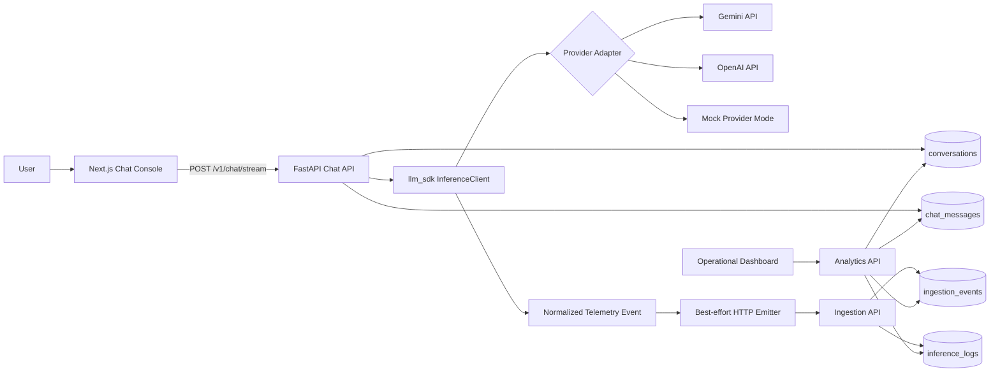
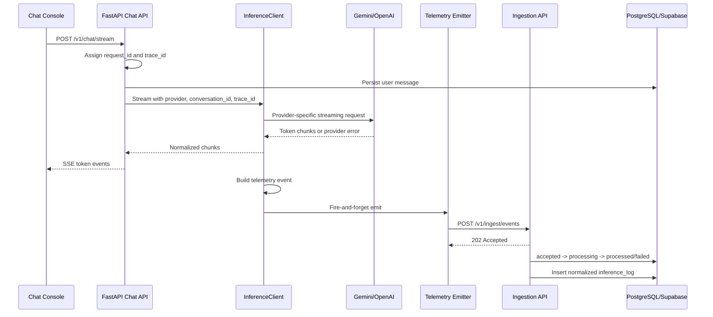
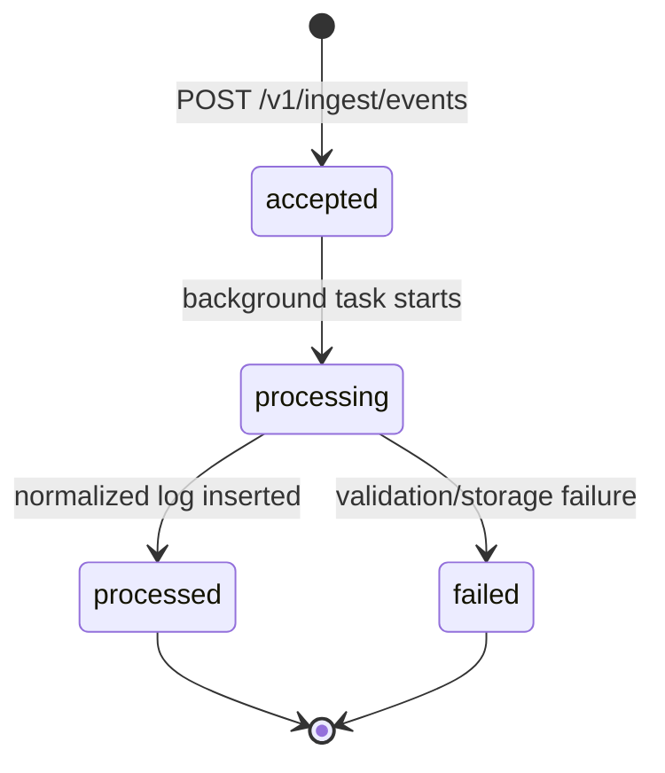

# Ollive Inference Platform

Ollive is a lightweight AI inference observability platform for LLM applications. It is intentionally not just a chatbot. The chat application exists as a workload generator for a small internal platform that captures, normalizes, persists, and visualizes inference telemetry across multiple model providers.

The system demonstrates the operational path that AI product teams usually need after the first prototype: provider abstraction, streaming inference, request traceability, best-effort telemetry emission, ingestion state tracking, normalized analytics, failure visibility, and deployable infrastructure.

## Executive Summary

This repository implements a production-oriented inference logging and observability system around a multi-turn LLM chat workload.

The core design principle is separation of concerns:

- The frontend owns user interaction, conversation selection, streaming rendering, and trace inspection.
- The API owns conversation state, request context, provider orchestration, ingestion endpoints, persistence, and analytics.
- The SDK owns provider abstraction, timing, retries, redaction, response normalization, and telemetry event construction.
- The ingestion pipeline owns validation, idempotency, state transitions, raw payload capture, and normalized inference logs.
- The dashboard owns operational interpretation of telemetry: latency, throughput, errors, token usage, provider health, ingestion state, and recent inference timelines.

Telemetry emission is intentionally decoupled from inference execution. Inference should not depend on observability storage being healthy, and observability should still capture provider failures when OpenAI or Gemini degrade, reject requests, or hit quota limits.

## What This Shows

- Multi-turn chatbot with conversation persistence, resume, list, and cancellation.
- Streaming responses over Server-Sent Events.
- Lightweight LLM SDK wrapper around provider calls.
- Multi-provider architecture with Gemini and OpenAI adapters.
- Provider-normalized inference telemetry.
- Request ID, trace ID, and correlation ID propagation.
- Structured JSON logging for operational debugging.
- PII redaction for telemetry previews.
- Best-effort telemetry emitter with bounded retries.
- Dedicated ingestion API and background processing path.
- `ingestion_events` lifecycle tracking: `accepted`, `processing`, `processed`, `failed`.
- Normalized `inference_logs` optimized for analytics and trace inspection.
- Operational dashboard with latency, throughput, errors, provider health, ingestion state, token usage, conversation activity, recent inference timeline, and trace inspector.
- Supabase/PostgreSQL integration with SSL and asyncpg pooler compatibility.
- Docker Compose deployment for local services.
- Self-hosted Kubernetes manifests with optional in-cluster Postgres and Supabase overlay.
- Managed PowerShell run scripts that prevent orphaned local dev processes on Windows.

## Repository Layout

```text
ARCHITECTURE_NOTES.md  Deep operational architecture and scaling analysis

apps/
  api/                 FastAPI chat, ingestion, persistence, analytics
  frontend/            Next.js chat console and telemetry inspector
  dashboard/           Next.js operational dashboard with Recharts

packages/
  llm_sdk/             Provider abstraction, inference client, telemetry emitter

architecture/
  diagrams.md          Mermaid architecture and lifecycle diagrams
  system-design.md     High-level service and module boundaries
  ingestion-flow.md    Event contract, lifecycle, idempotency
  scaling-notes.md     Scaling, storage, reliability notes

infrastructure/
  docker/              API and Next.js Dockerfiles
  kubernetes/          Self-hosted Kubernetes manifests and Supabase overlay
  scripts/             Local run, DB check, smoke test, cleanup scripts

docs/
  demo-notes.md        Demo path and screenshot checklist
```

## Architecture Overview

For the deeper systems writeup, see `ARCHITECTURE_NOTES.md`.

The platform is built around an explicit inference lifecycle:

1. A user sends a chat message from the Next.js chat console.
2. FastAPI creates or resumes a persisted conversation.
3. The API builds short conversational context.
4. `InferenceClient` selects a provider adapter.
5. The provider adapter calls Gemini, OpenAI, or deterministic mock mode.
6. Streaming chunks are returned to the browser over SSE.
7. The SDK creates a normalized telemetry event with timing, status, token usage, trace IDs, and redacted previews.
8. A best-effort telemetry emitter posts the event to the ingestion API.
9. The ingestion API validates the payload and schedules background processing.
10. The processor records raw payload state in `ingestion_events` and normalized facts in `inference_logs`.
11. The dashboard queries normalized analytics from `/v1/analytics/summary`.



## Request And Telemetry Lifecycle

The request path is deliberately split into two lifecycles: the user-facing inference lifecycle and the observability lifecycle.



Provider failures are also telemetry. If Gemini or OpenAI returns `429`, timeout, or another provider error, the SDK emits a failed telemetry event with provider, model, latency, trace ID, request ID, error type, and redacted request preview. This keeps the dashboard useful during provider degradation instead of hiding the failure behind a generic frontend error.

## Why Observability Matters For AI Inference

LLM calls are high-latency, externally dependent, cost-bearing operations. A normal CRUD request is usually observable through application logs and database metrics; an inference request requires additional dimensions:

- Which provider and model handled the request.
- Whether the provider succeeded, timed out, rejected the request, or hit quota.
- How long the provider call took.
- How many tokens were consumed.
- Which conversation/session generated the request.
- What safe preview can be shown for debugging.
- Which trace connects frontend behavior, API logs, provider calls, ingestion records, and dashboard rows.

This platform treats inference telemetry as operational data, not UI decoration. The dashboard is intentionally built around debugging and reliability workflows: throughput, tail latency, error rate, provider distribution, ingestion state, and recent traceable events.

## Provider Abstraction

Provider integration lives in `packages/llm_sdk/llm_sdk/providers`.

Implemented adapters:

- `GeminiProvider`
- `OpenAIProvider`
- Shared `BaseProvider` contract

The API never calls provider SDKs or HTTP endpoints directly. It calls `InferenceClient`, which resolves provider/model selection, times the call, normalizes responses, emits telemetry, and handles retries for non-streaming calls.

This boundary exists because provider APIs differ in request shape, streaming format, authentication, usage metadata, and error payloads. Without a normalization layer, analytics would become provider-specific and brittle. With the SDK boundary, dashboard queries can rely on stable fields such as:

- `provider`
- `model`
- `status`
- `latency_ms`
- `prompt_tokens`
- `completion_tokens`
- `total_tokens`
- `request_preview`
- `response_preview`
- `trace_id`
- `request_id`
- `correlation_id`

## Mock Provider Mode

`ALLOW_MOCK_PROVIDER=true` forces deterministic provider-shaped responses for Gemini and OpenAI. Mock mode is not a shortcut around the platform architecture.

The request still flows through:

```text
Chat UI -> FastAPI -> InferenceClient -> Provider Adapter -> Telemetry Event
-> Ingestion API -> ingestion_events -> inference_logs -> Analytics Dashboard
```

Mock mode exists for operational reasons:

- Provider quotas and billing limits should not block UI validation.
- Demos and screenshots need deterministic responses.
- Observability workflows should be testable without external network variability.
- The ingestion pipeline should be verifiable even when real providers are unavailable.

Real provider calls are supported by setting `ALLOW_MOCK_PROVIDER=false` and configuring `GEMINI_API_KEY` and/or `OPENAI_API_KEY`. If either provider returns quota errors, those failures are captured as telemetry.

## Ingestion Pipeline

The ingestion pipeline is intentionally separate from chat execution.



The ingestion route returns `202 Accepted` quickly and schedules processing with FastAPI background tasks. The processor then:

1. Inserts raw telemetry into `ingestion_events`.
2. Uses `event_id` uniqueness to avoid double-counting retries.
3. Marks the event `processing` and increments `retry_count`.
4. Writes normalized operational facts to `inference_logs`.
5. Marks the ingestion event `processed` or `failed`.

This design gives operators a raw audit trail and a queryable analytics table. If normalization fails, `ingestion_events` remains the debugging surface. If dashboard metrics look wrong, `inference_logs` is the stable analytical source.

## Traceability

Traceability is handled through request-scoped context variables and telemetry propagation.

The API middleware:

- Accepts incoming `x-request-id` and `x-trace-id` headers.
- Generates IDs when absent.
- Stores them in context variables.
- Adds them to response headers.
- Includes them in structured request logs.

The chat service passes those IDs to the SDK. The SDK adds them to telemetry events. Ingestion persists them in both `ingestion_events` and `inference_logs`. The dashboard displays them in the recent inference timeline and trace inspector with copy actions.

This lets an operator connect:

```text
browser request -> FastAPI log -> inference_started log -> provider call
-> ingestion_event -> inference_log -> dashboard timeline row
```

## PII Redaction

Telemetry previews are redacted before persistence. The redaction layer masks:

- Email addresses
- Phone-number-like strings
- Common secret-like tokens, including OpenAI-style `sk-...` values

The system keeps full chat messages in `chat_messages` for conversation replay, while telemetry previews are sanitized for operational visibility. In a production environment, retention and redaction policy would be tenant-specific, but this implementation already prevents observability tables from becoming a casual sensitive-data surface.

## Structured Logging

The API uses JSON logs with contextual fields. Important events include:

- `request_completed`
- `request_failed`
- `inference_started`
- `inference_completed`
- `inference_failed`
- `ingestion_event_processed`
- `telemetry_emit_failed`

Logs include request and trace context where available, plus provider, model, conversation ID, status, and latency for inference and ingestion flows.

Structured logs matter because inference issues often span multiple systems: browser, API, provider, ingestion worker, and database. Human-readable logs alone are not enough; logs need fields that can be filtered and correlated.

## Persistence Model

The schema is intentionally small but operationally meaningful.

### `conversations`

Stores session-scoped conversation lifecycle:

- `id`
- `session_id`
- `title`
- `status`
- `created_at`
- `updated_at`

Used for list, resume, and cancel workflows.

### `chat_messages`

Stores replayable conversation turns:

- `conversation_id`
- `role`
- `content`
- `provider`
- `model`
- `token_count`
- `created_at`

Assistant messages keep provider/model metadata so conversation replay can show which model produced each turn.

### `ingestion_events`

Stores raw telemetry payload and processing state:

- `event_id`
- `trace_id`
- `request_id`
- `status`
- `retry_count`
- `raw_payload`
- `error_message`
- `created_at`
- `processed_at`

This is the operational debugging table for ingestion health.

### `inference_logs`

Stores normalized inference facts:

- `event_id`
- `trace_id`
- `request_id`
- `correlation_id`
- `conversation_id`
- `session_id`
- `provider`
- `model`
- `status`
- `request_timestamp`
- `response_timestamp`
- `latency_ms`
- token counts
- redacted previews
- error metadata
- provider/transport metadata

This is the analytical table used by the dashboard.

Indexes are designed around common debugging paths: session/conversation replay, provider/status slicing, trace lookup, and time-window analytics.

## Analytics Dashboard

The dashboard is an operational console, not a generic admin template. It pulls from `/v1/analytics/summary` and refreshes periodically.

It shows:

- Request volume
- Error rate
- P50, P95, and P99 latency
- Total token usage
- Request throughput time series
- Failure time series
- Average latency and token load charts
- Provider health by provider
- Ingestion state and retry counts
- Conversation activity
- Request lifecycle strip
- Recent inference timeline
- Trace inspector with event, trace, request, provider, model, status, ingestion state, conversation ID, and request preview

The recent inference timeline is intentionally central. It gives reviewers and operators a compact view of what happened most recently, whether the provider succeeded, how ingestion processed the event, and which IDs can be used to correlate logs and database rows.

## API Surface

- `GET /health`
- `GET /`
- `GET /v1/conversations`
- `GET /v1/conversations/{conversation_id}`
- `POST /v1/conversations/{conversation_id}/cancel`
- `POST /v1/chat`
- `POST /v1/chat/stream`
- `POST /v1/ingest/events`
- `GET /v1/ingest/events`
- `GET /v1/analytics/summary`

## Local Development

Install dependencies:

```powershell
python -m pip install -r apps/api/requirements.txt -e packages/llm_sdk
cd apps/frontend
npm install
cd ..\dashboard
npm install
cd ..\..
```

Copy environment values:

```powershell
Copy-Item .env.example .env
```

For deterministic local demos:

```env
ALLOW_MOCK_PROVIDER=true
```

For real provider calls:

```env
ALLOW_MOCK_PROVIDER=false
GEMINI_API_KEY=...
GEMINI_MODEL=gemini-2.0-flash
OPENAI_API_KEY=...
OPENAI_MODEL=gpt-4o-mini
```

Start the services in three terminals from the repository root:

```powershell
.\infrastructure\scripts\run_api.ps1 -Port 5500
```

```powershell
.\infrastructure\scripts\run_frontend.ps1 -Port 3000
```

```powershell
.\infrastructure\scripts\run_dashboard.ps1 -Port 3001
```

Open:

- Chat: `http://localhost:3000`
- Dashboard: `http://localhost:3001`
- API docs: `http://localhost:5500/docs`

The `run_*.ps1` scripts stop existing listeners on the target port and start child processes inside a Windows job object. Closing the terminal or stopping the wrapper stops the managed `python` or `node` process tree, which prevents stale servers from holding ports.

## Supabase / PostgreSQL

The platform uses PostgreSQL as the persistence and analytics store. It supports local Docker Postgres and Supabase-managed Postgres.

For Supabase:

```env
DATABASE_URL=postgresql+asyncpg://...
DATABASE_SSL=true
DATABASE_SSL_MODE=require
DATABASE_PREPARED_STATEMENT_CACHE_SIZE=0
```

`DATABASE_SSL_MODE=require` preserves encrypted transport while avoiding local CA-chain issues that can appear on Windows. `DATABASE_PREPARED_STATEMENT_CACHE_SIZE=0` supports Supabase pooler compatibility with asyncpg.

Check connectivity and schema:

```powershell
$env:PYTHONPATH="C:\path\to\ollive-inference-platform\packages\llm_sdk;C:\path\to\ollive-inference-platform\apps\api"
python infrastructure/scripts/check_db.py
```

The prototype creates SQLAlchemy tables on API startup with `Base.metadata.create_all`. For production, this should move to Alembic migrations executed as a separate deployment step or Kubernetes Job.

## Docker Deployment

Run the local Docker stack:

```powershell
docker compose up --build
```

Services:

- API: `http://localhost:8000`
- Chat frontend: `http://localhost:3000`
- Dashboard: `http://localhost:3001`
- Postgres: `localhost:5432`

Run against Supabase without the local Postgres container:

```powershell
docker compose -f docker-compose.supabase.yml up --build
```

The API Dockerfile installs the local SDK package in editable mode and sets `PYTHONPATH` for the API and SDK. The Next.js Dockerfile accepts build args for `NEXT_PUBLIC_API_BASE_URL`, `NEXT_PUBLIC_CHAT_URL`, and `NEXT_PUBLIC_DASHBOARD_URL` because public Next.js environment values are baked into the client bundle at build time.

## Self-Hosted Kubernetes

Kubernetes manifests live in `infrastructure/kubernetes`.

The base deployment includes:

- `Namespace`
- `ConfigMap`
- Secret template
- API `Deployment` and `Service`
- Frontend `Deployment` and `Service`
- Dashboard `Deployment` and `Service`
- Optional PostgreSQL `StatefulSet`
- NGINX-compatible `Ingress`

The Supabase overlay removes in-cluster Postgres and patches database settings for SSL/pooler compatibility:

```powershell
kubectl apply -k infrastructure/kubernetes/overlays/supabase
```

The ingress disables proxy buffering and extends read/send timeouts so SSE responses are not cut short by the ingress controller.

See `infrastructure/kubernetes/README.md` for image build commands, secret creation, kind image loading, ingress hostnames, and operational caveats.

## Verification

Check database connectivity:

```powershell
python infrastructure/scripts/check_db.py
```

Run an end-to-end smoke test:

```powershell
python infrastructure/scripts/e2e_smoke.py --api-base-url http://127.0.0.1:5500 --provider gemini --stream
python infrastructure/scripts/e2e_smoke.py --api-base-url http://127.0.0.1:5500 --provider openai --stream
```

Use `--require-success` only when the selected provider key has active quota. Without quota, provider failures are still valid observability events and should appear as `error` rows in the dashboard.

Operational verification checklist:

- API `/health` returns `{"status": "ok"}`.
- Chat messages are persisted in `chat_messages`.
- Conversations can be listed, resumed, and cancelled.
- Streaming emits SSE `conversation`, `token`, `done`, or `error` events.
- `ingestion_events` contains raw payloads and processing states.
- `inference_logs` contains normalized provider/model/status/latency/token fields.
- Dashboard request count, error rate, provider distribution, ingestion state, and timeline update after a request.
- Structured logs include `request_id`, `trace_id`, provider, model, and conversation ID.

## Screenshots To Capture

Store final demo images in the root `screenshots/` directory:

- `screenshots/dashboard-overview.png`
- `screenshots/inference-timeline.png`
- `screenshots/telemetry-inspector.png`
- `screenshots/chat-console.png`
- `screenshots/streaming-response.png`
- `screenshots/provider-health.png`
- `screenshots/supabase-inference-logs.png`
- `screenshots/supabase-ingestion-events.png`
- `screenshots/kubernetes-manifests.png`
- `screenshots/docker-compose.png`
- `screenshots/architecture-diagram.png`

See `screenshots/README.md` for the capture checklist and exact naming convention.

## Engineering Tradeoffs

### One FastAPI Service, Multiple Internal Boundaries

Chat, ingestion, and analytics run in one FastAPI service for local deployability. The internal boundaries remain explicit: routers, services, repositories, SDK, provider adapters, and telemetry emitters are separated so they can later move into independent services.

### Background Tasks Instead Of A Durable Queue

FastAPI background tasks demonstrate async isolation without adding Kafka, SQS, Redis Streams, or worker infrastructure. In production, ingestion should move behind a durable queue or outbox worker so events survive process restarts and can be replayed with backpressure.

### PostgreSQL For Early Analytics

PostgreSQL is used for application state and operational analytics because it is sufficient for early-stage workloads and keeps deployment simple. At higher volume, `inference_logs` should be partitioned by time, rollups should be materialized, and long-retention telemetry should move into OLAP/object storage.

### Streaming Retry Boundary

Non-streaming inference can retry before returning a response. Streaming does not retry after partial output because replaying a model stream can duplicate tokens and confuse the user. Streaming failures are surfaced as SSE `error` events and still produce failed telemetry.

### Managed Supabase Over Self-Hosted Database Operations

Supabase-managed PostgreSQL reduces operational database overhead for a take-home platform and allows the work to focus on inference telemetry, observability, and failure isolation. The Kubernetes base still includes an in-cluster Postgres option for self-hosted demos.

## Known Operational Boundaries

- Real Gemini/OpenAI success depends on external provider quota and billing.
- Mock mode should be used for deterministic demos when provider quota is unavailable.
- Startup `create_all` is acceptable for the prototype but should become Alembic migrations.
- Background ingestion tasks are not durable across process termination.
- Streaming token usage is approximated locally by word count; non-streaming calls use provider-reported usage when available.
- Authentication, tenant isolation, and retention policies are not implemented yet.
- Kubernetes manifests are deployable templates, but production hardening would require secrets management, TLS, autoscaling, migrations, and database backups.

## Future Evolution

- Alembic migration pipeline.
- Durable queue for ingestion processing.
- Dead-letter queue and replay tooling for failed telemetry.
- Provider usage reconciliation for streaming responses.
- OpenTelemetry spans across frontend, API, SDK, provider calls, ingestion, and database writes.
- Tenant/project dimensions and API keys.
- Authenticated dashboard and role-based access.
- Metrics rollups for high-cardinality dashboards.
- Partitioned inference logs and retention policies.
- Export pipeline to warehouse or object storage.
- Provider fallback policy and circuit breakers.
- Synthetic provider health checks.
- Cost analytics and budget alerts.

## Summary

OPENSOURCE

This project is a compact version of an internal AI platform: it runs a real chat workload, wraps provider calls in an SDK boundary, emits normalized telemetry, processes ingestion asynchronously, persists both raw and normalized observability data, and exposes an operational dashboard for debugging provider behavior and inference performance.

The value is not the chatbot alone. The value is the platform boundary around inference execution: traceability, normalized telemetry, failure isolation, provider abstraction, persistence, and operational visibility.
